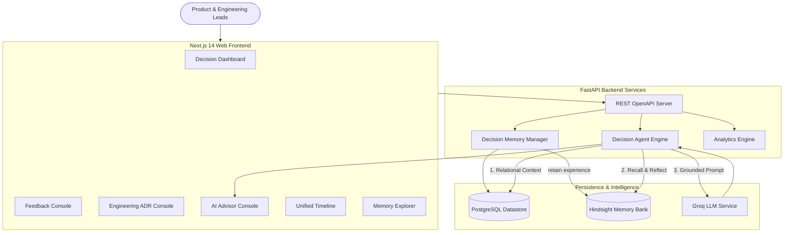

# Decision Memory

> **Remember what your organization decided, why it decided it, and what happened afterward.**

Decision Memory is an enterprise organizational memory system built for product and engineering teams. It connects customer feedback, product decisions, engineering architecture decision records (ADRs), experiments, and observed outcomes into a unified experience memory graph powered by **Hindsight by Vectorize**.

---

## 💡 The Core Problem

Product and engineering teams repeatedly encounter problems they have already solved because people forget:
* Why a technology was selected vs why an alternative was rejected
* What constraints existed at the time of the decision
* What trade-offs were accepted
* What product decisions were made and what engineering decisions supported them
* What actually happened after implementation (measured outcomes)
* What lessons were learned

**Decision Memory** acts as durable organizational memory that retains this experience and uses it when future product or engineering questions arise.

---

## 🔄 Core Product Loop

```
Customer Feedback
→ Product Decision
→ Engineering Decision (ADR)
→ Implementation
→ Outcome
→ Hindsight Retain
→ Future Question
→ Hindsight Recall & Reflect
→ Historical Evidence
→ Better Decision
→ New Outcome
→ Hindsight Retain
```

---

## 🏛️ System Architecture



---

## 🗄️ Database vs Hindsight Memory Layer

| Aspect | PostgreSQL Datastore | Hindsight by Vectorize |
| :--- | :--- | :--- |
| **Purpose** | Relational Application State | Durable Organizational Experience |
| **Stored Items** | Feedbacks, Product Decisions, ADRs, Experiments, Outcomes | Reasoning, Context, Rejected Options, Constraints, Lessons |
| **Retrieval** | Structured SQL Foreign Keys | Vector + Knowledge Graph + Temporal Indexing |
| **Primitives** | INSERT / UPDATE / SELECT | `retain` / `recall` / `reflect` |

---

## 🚀 Key Features

* **Real Organizational Decision Dashboard**: Visual metrics for Feedback, Product Decisions, Engineering ADRs, Experiments, Learned Memory, and Outcomes with Recharts analytics.
* **Architecture Decision Record (ADR) Engine**: Inspired by enterprise ADR standards. Captures decisions, constraints, trade-offs, and explicitly rejected alternatives.
* **Decision Intelligence AI Advisor**: Non-chatbot decision console for querying organizational memory prior to making new choices.
* **Side-by-Side Memory Impact Comparison**: Directly compares recommendations **Without Organizational Memory (OFF)** vs **With Hindsight Memory (ON)**.
* **Evidence Panel UI**: Transparently displays retrieved historical facts, dates, rejected options, and "Why this matters".
* **Unified Organizational Timeline**: Chronological visual flow of Problem → Decision → Implementation → Outcome → New Decision.
* **Memory Explorer**: Filterable index of retained Hindsight memories across Feedback, Decisions, Rejected Alternatives, Outcomes, and Lessons.

---

## ⚙️ Tech Stack & Environment Setup

### Backend
* Python 3.11+
* FastAPI
* SQLAlchemy & Pydantic
* PostgreSQL / SQLite
* Hindsight Cloud & REST API Client
* Groq LLM Client

### Frontend
* Next.js 14 App Router
* TypeScript & Tailwind CSS
* Lucide Icons & Recharts

### Environment Variables (`.env`)
```bash
HINDSIGHT_API_KEY=your_hindsight_api_key
HINDSIGHT_BASE_URL=https://api.hindsight.vectorize.io
HINDSIGHT_BANK_ID=product-engineering-memory
GROQ_API_KEY=your_groq_api_key
GROQ_MODEL=llama-3.3-70b-versatile
DATABASE_URL=sqlite:///./decision_memory.db
```

---

## 🛠️ Quickstart & Local Development

### Option 1: Running Locally

1. **Install Backend Dependencies**:
   ```bash
   cd backend
   pip install -r requirements.txt
   ```

2. **Start Backend Server**:
   ```bash
   uvicorn app.main:app --port 8000 --reload
   ```

3. **Install Frontend Dependencies & Start Next.js App**:
   ```bash
   cd frontend
   npm install
   npm run dev
   ```

4. **Access Applications**:
   * Web App: [http://localhost:3000](http://localhost:3000)
   * API Docs: [http://localhost:8000/docs](http://localhost:8000/docs)

### Option 2: Running with Docker Compose

```bash
docker-compose up --build
```

---

## 🧪 Testing & Verification

Run the automated verification suite covering all 22 required test cases:

```bash
python scripts/test_memory_loop.py
```

Output:
```
=================================================================
      Decision Memory - Complete Verification Test Suite       
=================================================================
[Test 01/22] Testing application startup initialization... OK
[Test 02/22] Testing Database connection... OK
[Test 03/22] Testing Hindsight connection... OK
...
[Test 22/22] Testing LLM failure handling & grounded fallback engine... OK

=================================================================
   ALL 22/22 VERIFICATION TESTS PASSED SUCCESSFULLY!   
=================================================================
```

---

## 📋 API Endpoints Reference

### Feedback
* `POST /api/feedback` - Record customer feedback
* `GET /api/feedback` - List feedback items
* `POST /api/feedback/{id}/analyze` - Analyze feedback with Hindsight memory

### Product Decisions
* `POST /api/product-decisions` - Record product decision & retain in Hindsight
* `GET /api/product-decisions` - List product decisions

### Engineering Decisions (ADRs)
* `POST /api/engineering-decisions` - Record ADR & retain in Hindsight
* `GET /api/engineering-decisions` - List engineering ADRs

### AI Advisor & Memory
* `POST /api/agent/advice` - Get grounded decision advice (Memory ON / OFF)
* `POST /api/agent/compare` - Run side-by-side memory impact evaluation
* `POST /api/memory/retain` - Retain experience in Hindsight
* `POST /api/memory/recall` - Recall memories matching query
* `POST /api/memory/reflect` - Agentic synthesis of memory bank
* `GET /api/memory/events` - Explore retained memory index

### Timeline & Demo
* `GET /api/timeline` - Get unified organizational timeline
* `POST /api/demo/load` - Load 60-80 synthetic demo events
* `POST /api/demo/reset` - Reset demo dataset

---

## 💬 Example Question & Memory-Based Recommendation

### Question
> *"Should we migrate search from PostgreSQL to Elasticsearch?"*

### Recommendation Without Memory (Memory OFF)
> *"Based on general software engineering patterns, Elasticsearch provides advanced full-text indexing, vector search, and horizontal scaling. Consider deploying an Elasticsearch cluster."*

### Recommendation With Hindsight Memory (Hindsight ON)
> *"Do not migrate to Elasticsearch immediately. On Feb 12, 2026, the engineering team evaluated Elasticsearch, OpenSearch, and PostgreSQL. Elasticsearch was rejected because current scale and operational complexity did not justify managing an external cluster. On Apr 04, 2026, PostgreSQL search optimization reduced query latency by 42%. Audit current workload metrics against original Feb 2026 scale constraints before altering infrastructure."*
