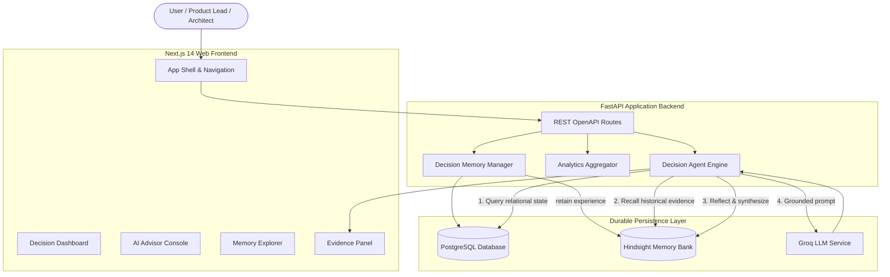
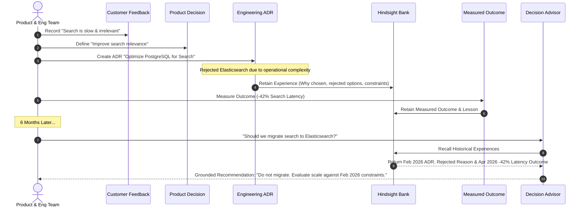

# System Architecture: Decision Memory

**Decision Memory** is an enterprise organizational memory system designed to connect customer feedback, product decisions, engineering decisions (ADRs), experiments, and observed outcomes using Hindsight by Vectorize.

## System Topology & Data Flow

## Architectural Decoupling: PostgreSQL vs Hindsight

| Responsibility | PostgreSQL Datastore | Hindsight by Vectorize |
| :--- | :--- | :--- |
| **Data Nature** | Relational Application State | Durable Organizational Experience |
| **Entities Stored** | Customers, Feedbacks, Decisions, Experiments, Outcomes | Reasoning, Constraints, Rejected Alternatives, Lessons Learned |
| **Search Mechanism** | SQL Indexed Foreign Key Queries | Vector + Graph Traversal + Temporal Search |
| **Primitives** | INSERT / UPDATE / SELECT | retain / recall / reflect |
| **Availability** | Primary Application State | Resilient Proxy Fallback |

## Memory Loop Lifecycle

